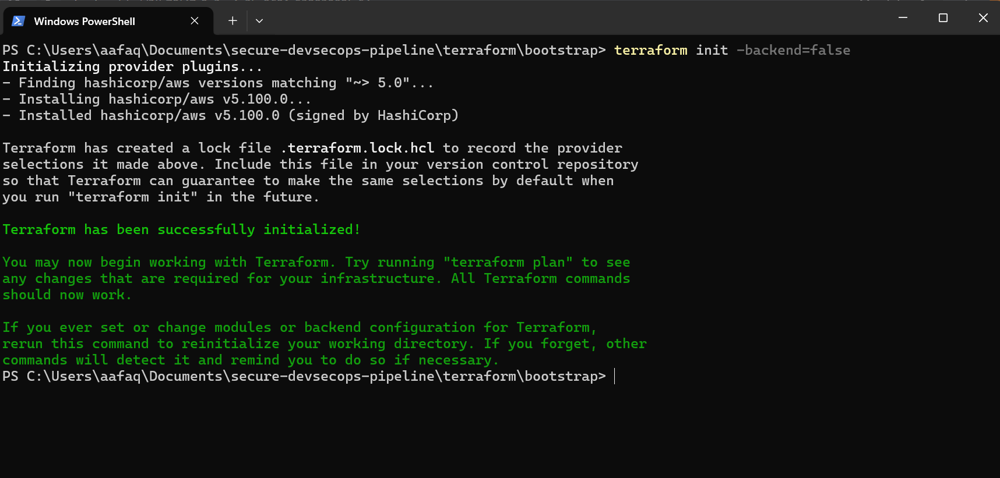
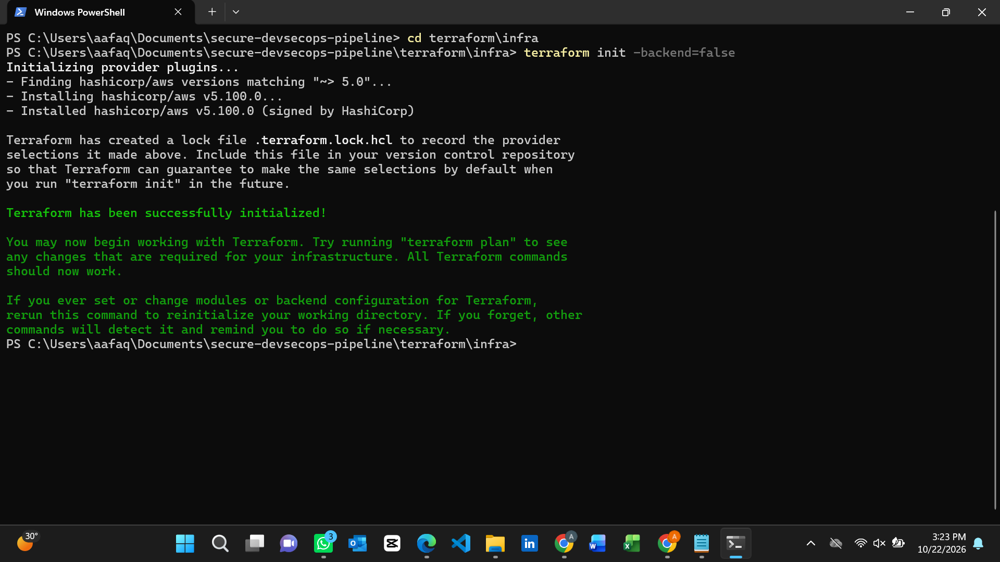
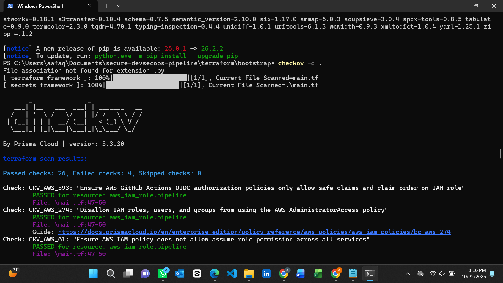
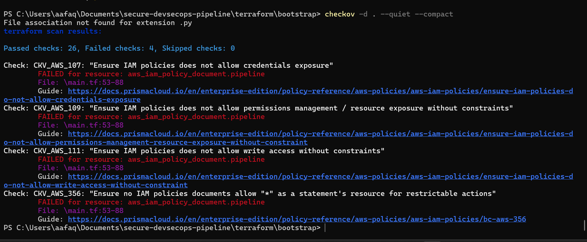
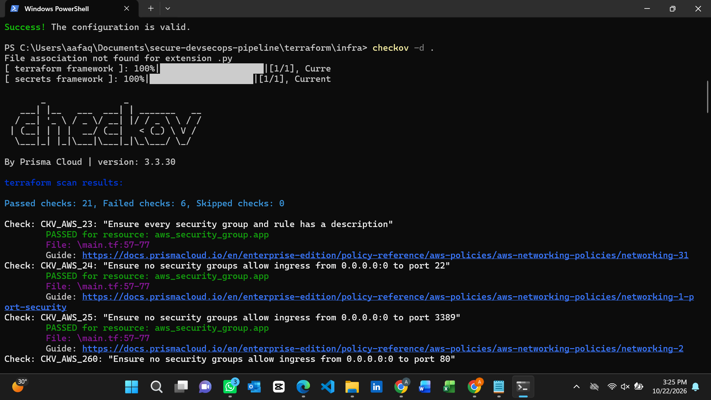
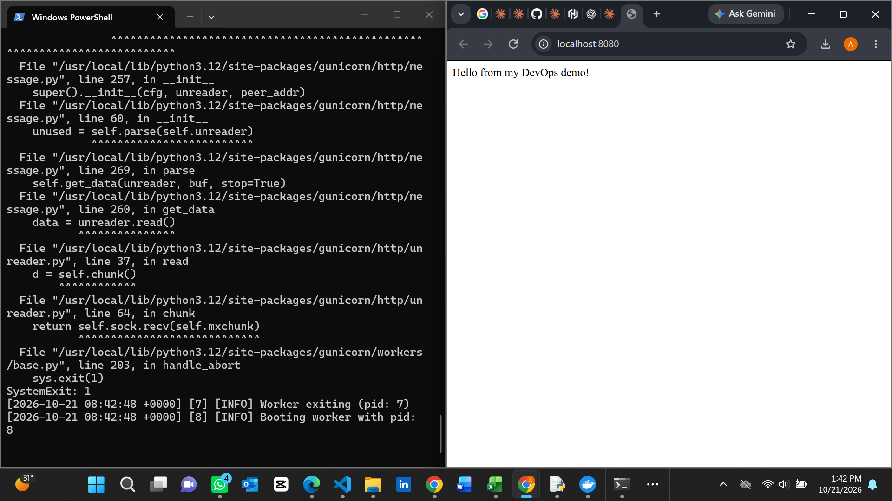
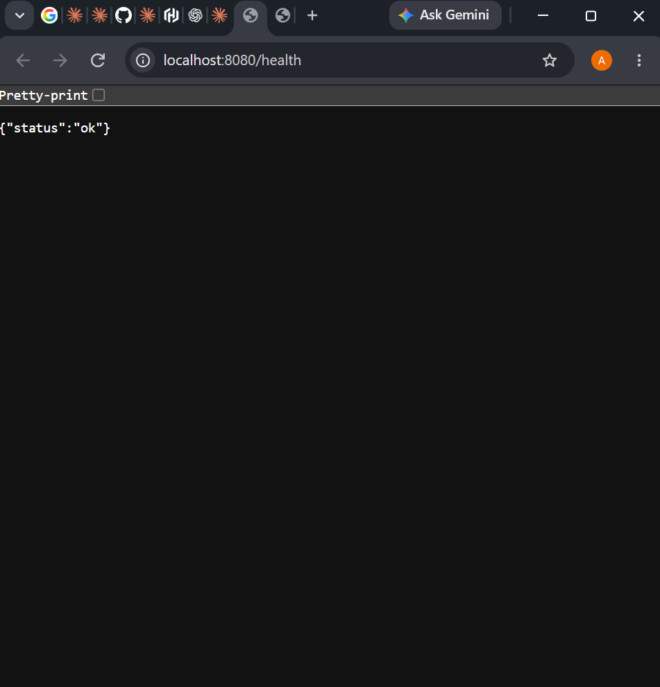
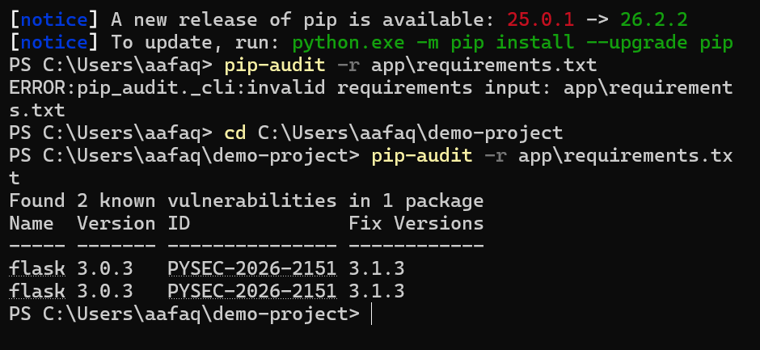
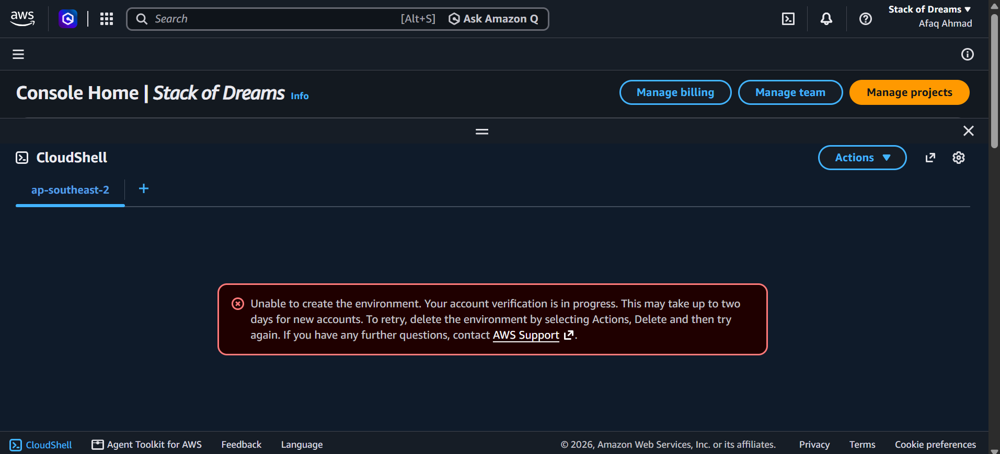

# Secure DevSecOps Pipeline on AWS

Infrastructure-as-code project: a hardened EC2 environment and keyless
GitHub Actions to AWS authentication, built with Terraform and Docker.

## Status

- ✅ Terraform code written, formatted and validated
- ✅ Static security scan with Checkov (26 passed, 4 findings documented below)
- ✅ Container built and run locally with Docker (non-root user)
- ⏳ AWS deployment not completed: my new AWS account was stuck in
  verification (support case opened), so `terraform apply` and the
  GitHub Actions deployment have not been run yet.

## What's in this repo

- `terraform/bootstrap`: GitHub OIDC provider and a pipeline IAM role.
  The trust policy is restricted to this repo and the `main` branch, so
  no AWS access keys are stored in GitHub.
- `terraform/infra`: VPC, public subnet, security group (port 8080 only,
  no SSH), EC2 instance with IMDSv2 required, encrypted root volume, and
  SSM Session Manager access.
- `Dockerfile` and `app/`: a small app that runs as a non-root user.
- `.github/workflows`: GitHub Actions workflows.

## Security decisions

- No SSH. Access is through SSM Session Manager.
- Short-lived credentials via OIDC instead of stored access keys.
- IAM role actions limited to resources named `devsecops-*`.
- IMDSv2 required and the EBS volume encrypted.

## Known limitations (Checkov findings)

| Check | Issue | Plan |
|---|---|---|
| CKV_AWS_107, 111, 356 | `ec2:*` on `*` is broader than needed | Narrow it using CloudTrail and IAM Access Analyzer after a first run, then add region and tag conditions |
| CKV_AWS_109 | Pipeline needs IAM actions to create roles | Already scoped by name; consider a permissions boundary |

## Screenshots

### Terraform setup

### Checkov IaC security scan

### Container and health check

### Dependency scanning

### AWS account blocker

## What I'd do next

- Deploy once the AWS account is active
- Narrow the pipeline permissions and re-run Checkov
- Add container image scanning with Trivy